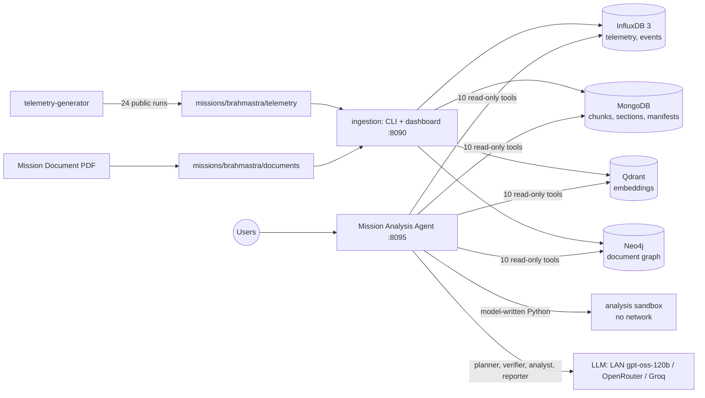

# Agentic Setup Demo — Mission Analysis Agent

An end-to-end demonstration of an **agentic AI system for mission data analysis**, built around *Brahmastra*, a fictional missile health-monitoring dataset. It covers:

- generating and validating synthetic telemetry;
- ingesting it with technical documents into four specialised stores;
- a multi-user web application in which a **Plan → Execute → Verify → Recover → Replan** agent investigates questions, cites its evidence, and lets you replay every step.

> Brahmastra and all its data are **fictional and non-operational**. The telemetry is synthetic; channel values are normalised units with no engineering meaning.

## What's inside

| Folder | Contents |
|---|---|
| [`telemetry-generator/`](telemetry-generator) | Deterministic generator (Python/NumPy) for 24 runs × 48 channels × 900 s, its source registry, and an independent 62-check validator |
| [`data-ingestion/`](data-ingestion) | Docker Compose stack, ingestion pipeline and CLI (PyMuPDF, local embeddings, optional VLM), ingestion dashboard, store viewers, and the Brahmastra inputs (Mission Document + 24 runs) |
| [`mission-analysis-agent/`](mission-analysis-agent) | The web app (React + Fastify + LangGraph.js, TypeScript) and the analysis sandbox (Python) |
| [`docs/`](docs) | The guides below |
| [`scripts/publish-images.sh`](scripts/publish-images.sh), [`.github/workflows/images.yml`](.github/workflows/images.yml) | Multi-architecture image publishing to Docker Hub |



## The agent in one paragraph

For each question, a **planner** model writes:

- an objective;
- competing hypotheses, each with what would confirm or refute it;
- a dependency-ordered plan of tool calls.

The tools (document search, sections, tables, figures, channels, runs, telemetry and event windows, graph neighbours, and sandboxed Python analysis) run in parallel where they can. After each step, a **verifier** model rates every hypothesis against the evidence and the documented rules, then decides whether to continue, replan, ask the user, or report.

When anything fails, a **recovery** step chooses one of five routes:

- retry, possibly with corrected arguments;
- continue without the failed step;
- revise the plan;
- ask the user;
- answer partially.

Retry and revision budgets bound every one of these routes.

A **reporter** drafts the answer: each factual claim with the evidence it rests on and the exact words quoted from it. A **claim check** then verifies every quote against the evidence text, and asks a checker model whether any evidence contradicts a claim, for example a heading mistaken for a table row. Failed claims send the draft back to be rewritten, or back to planning to fetch more, and confidence is capped by what could be verified. The published answer carries citations, a confidence, the alternatives it rejected, and its open uncertainties. Every event is logged, so any answer can be replayed: the agent graph, the evolving plan graph with its recovery lane, and each model call and tool result.

## Quick start

Requires Docker with Compose v2 (8 GB memory for Docker), Python 3 and Git. Full details: [Guide 1](docs/01-infrastructure.md).

```bash
git clone https://github.com/ssri14/Agentic-Setup-Demo.git
cd Agentic-Setup-Demo/data-ingestion
python3 scripts/setup.py                                   # creates .env and secrets/ (never committed)
# edit .env: LLM_BASE_URL / LLM_MODEL (or OPENROUTER_API_KEY / GROQ_API_KEY)
docker compose pull dashboard agent-web analysis-sandbox influxdb mongo neo4j qdrant
docker compose up -d influxdb neo4j mongo qdrant
docker compose run --rm ingest init
docker compose --profile setup run --rm agent-provision
docker compose up -d dashboard analysis-sandbox agent-web
docker compose run --rm ingest telemetry                   # 24 runs  (or use the dashboard)
docker compose run --rm ingest documents                   # Mission Document
```

Then:

- open the **ingestion dashboard** at http://localhost:8090;
- open the **agent** at http://localhost:8095 and sign in as `admin` with `AGENT_ADMIN_PASSWORD` from `.env`.

## Guides

1. [Setting up the infrastructure with Docker Compose](docs/01-infrastructure.md): services, requirements, published images or local builds, configuration, operations, backups, publishing images
2. [Generating and ingesting telemetry](docs/02-telemetry.md): the dataset, generation, validation, ground-truth separation, loading and checking
3. [Chunking and ingesting a document](docs/03-documents.md): sections, chunks, tables, figures, VLM enrichment, embeddings, the knowledge graph, new missions
4. [Guide for administrators](docs/04-administrators.md): users and access, models, tool bench, budgets and recovery, fault injection, security
5. [Guide for users](docs/05-users.md): asking questions, reading answers and evidence, the replay

Technical references: [`data-ingestion/README.md`](data-ingestion/README.md), [`mission-analysis-agent/README.md`](mission-analysis-agent/README.md), [`telemetry-generator/README.md`](telemetry-generator/README.md), [`data-ingestion/viewers/README.md`](data-ingestion/viewers/README.md).

## Container images

| Image | Built from |
|---|---|
| `ssri14/mission-analysis-ingestion` | `data-ingestion/` (CLI and dashboard) |
| `ssri14/mission-analysis-agent` | `mission-analysis-agent/` |
| `ssri14/mission-analysis-sandbox` | `mission-analysis-agent/sandbox/` |

Tags: `1.0.7` (current), earlier versions, and `latest`, for `linux/amd64` and `linux/arm64`. Compose uses `IMAGE_NAMESPACE` and `IMAGE_TAG` from `.env`. To publish, see [Guide 1 → Publishing images](docs/01-infrastructure.md#publishing-images).

## Not in this repository

- **Credentials**: `.env` and `secrets/` are generated per machine by `setup.py`.
- **Evaluator ground truth**: `telemetry-generator/evaluator_only/` holds the run-to-scenario answers. It is created locally by the generator and never committed or ingested.
- **Generated artifacts**: rendered pages, extraction reports and model caches.
