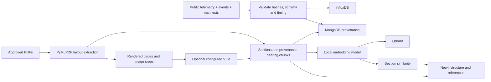

# Mission data ingestion

The ingestion side of the stack and the home of its Docker Compose project (which also runs the Mission Analysis Agent from `../mission-analysis-agent`). Step-by-step guides are in [`../docs`](../docs): [infrastructure](../docs/01-infrastructure.md), [telemetry](../docs/02-telemetry.md), [documents](../docs/03-documents.md). This README is the technical reference. See [VALIDATION.md](VALIDATION.md) for the executed checks.

| Store | Responsibility |
|---|---|
| InfluxDB 3 Core | Typed telemetry and event time series, queried with SQL |
| MongoDB | Document revisions, sections, chunks, tables, asset metadata, run manifests and ingestion status |
| Neo4j Community | Document structure, reading order, explicit references, entity mentions and related-section links |
| Qdrant | Local text embeddings and filtered cosine-similarity search |
| Named volume / local artifacts | Downloaded embedding weights / rendered pages, extracted images, cached VLM results and extraction reports |



## Start here

Requires Docker Engine/Desktop with Compose v2 or later and Python 3 on the host for the setup script. The container runs Python 3.12; host Python packages are not needed. Allocate approximately 6 GB RAM to Docker. The initial image/model downloads require internet access. The CPU image is intended for macOS Apple Silicon/Intel, Linux amd64/arm64 and Windows with Docker Desktop Linux containers. Only Apple Silicon has been exercised so far; other platforms still need a smoke test.

Open a terminal in **this folder**, then run:

```bash
python3 scripts/setup.py
docker compose up -d influxdb neo4j mongo qdrant
docker compose build ingest
docker compose run --rm ingest init
docker compose up -d dashboard        # http://localhost:8090
```

On Windows, use `python` instead of `python3` if necessary. All remaining commands are the same in PowerShell.

`setup.py` creates random local database credentials in `.env` and `secrets/influx-admin.json`. It preserves existing files. The Brahmastra inputs are already versioned in `missions/brahmastra/`; `--seed-demo` copies freshly generated runs from `../telemetry-generator/agent_visible/runs` into it if any are missing. There are no absolute host paths in Compose, and no mounts of the draft-data parent folder.

The generated `.env` and `secrets/` must accompany an existing deployment when restarting it. Changing their initial passwords/token does not rotate credentials already persisted in database volumes. They are excluded from Git and the Docker build context. Store ports bind to localhost. This is a local demo deployment; ingestion uses an administrative identity, and the agent connects with its own least-privilege MongoDB user.

## Missions and the ingestion dashboard

A **mission** is an isolated corpus with its own stores. The mission registry lives in the MongoDB database `mission_registry`.

| Mission | Inputs | MongoDB | InfluxDB | Qdrant | Neo4j |
|---|---|---|---|---|---|
| `brahmastra` (built in) | `missions/brahmastra/{documents,telemetry}` | `brahmastra` | `brahmastra` | `document_chunks` | nodes with `mission='brahmastra'` |
| `<id>` (created later) | `missions/<id>/{documents,telemetry}` | `mission_<id>` | `mission_<id>` | `<id>_chunks` | nodes with `mission='<id>'` |

Brahmastra keeps the store names it was first ingested with. Neo4j Community has one graph, so every `Document`, `Section`, `Chunk`, `Asset` and `Entity` node carries a `mission` property, and entity IDs are mission-scoped (`brahmastra:DAQ`, with `name` = `DAQ`). `init` and the dashboard tag pre-existing Brahmastra nodes once; this is idempotent. Because document IDs are content-addressed, the same PDF and profile can belong to only one mission; ingesting it into a second mission is refused.

The **dashboard** at http://localhost:8090 shows:
- the health of every service: the four stores, the embedding cache, the VLM and text-LLM endpoints, the optional viewers and free artifact space
- a mission picker and **New mission** form
- the mission's store names and counts
- PDF upload by drag and drop, with **Ingest** (native) and **Ingest + VLM** buttons for each file
- an ingestion job queue with live progress and logs.

Jobs run one at a time, the same single-writer rule as the CLI. Don't run CLI ingestion while a dashboard job is running. Job history is kept in `mission_registry.dashboard_jobs`; a job interrupted by a dashboard restart is marked `interrupted` and can simply be started again. Telemetry ingestion is available only for missions with the Brahmastra RC1 telemetry schema. Uploads must be real PDFs (at most 200 MB, `MAX_UPLOAD_MB`), and an existing filename is never overwritten.

The CLI accepts `--mission` before the command (default `brahmastra`):

```bash
docker compose run --rm ingest missions
docker compose run --rm ingest create-mission trishul "Trishul" --description "Second fictional mission"
docker compose run --rm ingest --mission trishul documents --file "Some Document.pdf"
```

## Telemetry ingestion and retrieval

```bash
# Preflight without connecting to databases:
docker compose run --rm ingest telemetry --validate-only

# Load all runs, or one run:
docker compose run --rm ingest telemetry
docker compose run --rm ingest telemetry --run BM-RUN-0001

# Discover versioned dataset/document IDs:
docker compose run --rm ingest status

# Paste a dataset_id from the preceding output:
docker compose run --rm ingest window DATASET_ID --start 310 --end 350 --channels seq_subphase_id,stg_state,log_backlog
docker compose run --rm ingest window DATASET_ID --start 310 --end 350 --events
```

A dataset is a content-addressed revision of one public run. `telemetry` and `mission_events` use `run_id` and `dataset_id` tags. The time index is the **source timestamp**, with the original source/received strings, integer received nanoseconds, elapsed seconds and sample index retained. The 48 channels are typed fields, including Boolean, integer, float and enum/string values. A separate `event_id` tag prevents simultaneous events from overwriting one another. Query windows use half-open elapsed intervals `[start, end)` and include the manifest's absolute source-time bounds.

The loader verifies the two content hashes, manifest counts, all 54 CSV columns, typed values, public enums, UTC timestamps, source sample grid and cumulative counter monotonicity. It refuses restricted source paths and private labels in manifests. It preserves intentional capture gaps; it does not interpolate missing samples, rewrite conflicting states, or confuse `BACKFILLED` delivery with acquisition loss. This is input validation, not a replacement for the original independent scenario validator or a claim that every mission rule passes in anomalous runs.

InfluxDB writes use batches of 500. Re-ingesting the identical source revision writes identical point identities and verifies persisted counts. A changed source manifest or data hash creates another dataset revision rather than silently replacing history. MongoDB marks a run complete only after the time-series counts agree. Retry a failed run with the same command. There is no global distributed transaction.

No retention period is configured: fictional observations from January 2026 must remain queryable. InfluxDB 3 Core was deliberately selected with its native HTTP/SQL API; this is not an InfluxDB 2/Flux application. Its default query-file limit corresponds to about 72 hours of normal ingest. These 15-minute demo runs fit well within that scope; longer histories require evaluating Core's file-limit/performance tradeoffs or another edition.

## Document extraction

```bash
# Inspect native extraction without databases, embeddings or VLM calls:
docker compose run --rm ingest documents --extract-only

# Extract, embed, and publish native content:
docker compose run --rm ingest documents
```

The PDF pipeline uses PyMuPDF text blocks, font information, image bounding boxes, page rendering and native table extraction. It groups adjacent text blocks within a page/section, splits long blocks at word boundaries, and keeps page, bounding box, original block text, character offsets, content kind and stable IDs. Chunk boundaries never cross major sections. Local embeddings use overlapping token windows and pooling so long chunks are not silently truncated to the model input limit.

For the Mission Document, `SEC-01` through `SEC-10` running headers define major sections, including multi-page sections. Front matter is separate. Top-level PDF outlines are the fallback for conventional bookmarked documents. PDFs with neither convention use **explicitly labeled page fallback units**; generic heading hierarchy inference is not implemented. Fine subsection titles remain within text chunks. Inspect `artifacts/<document_id>/extraction.json` before treating a new document's section structure as approved.

Every page is rendered, and embedded images receive separate crops. PyMuPDF native table candidates retain cells and bounding boxes; disconnected row backgrounds can yield fragments, so these candidates are not asserted to be complete tables. Full-page VLM processing can capture tables that native detection misses and describe vector diagrams that are not embedded raster images.

### Add the VLM

Edit the generated `.env`:

```dotenv
VLM_BASE_URL=https://openrouter.ai/api/v1
VLM_MODEL=YOUR_VISION_CAPABLE_MODEL
VLM_API_KEY=YOUR_KEY
```

Alternatively configure a local OpenAI-compatible vision server and use `http://host.docker.internal:PORT/v1` from containers. Local servers that do not require authentication can leave the key empty.

```bash
docker compose run --rm ingest documents --enrich
```

This sends each rendered page to the configured provider. The model returns a validated schema containing figure descriptions, table headers/rows, and optional transcription for pages without native text. Row widths are checked. Descriptions and transcriptions are labeled `vlm_description`, `vlm_table` or `vlm_transcription`, and retain their page asset, model and cache key. They do not replace source text or count as authoritative operating limits. VLM evidence has **page-level** localization; precise figure/table boxes are available for native extraction, not asserted for model results.

Results are cached by rendered-page hash, native context, model endpoint/identifier and prompt hash. Once the extraction report is complete, the source/profile revision is frozen and reused after verifying its asset hashes; changing provider behavior cannot silently rewrite that extraction on an ordinary retry. Use a new pipeline version/profile to intentionally regenerate it. A retry reuses accepted responses. Invalid JSON or inconsistent table shapes trigger up to two correction requests using the same page; invalid responses are retained for inspection. HTTP failures or validation failure after three attempts stop the command; there is no silent switch to a text-only result. `native_only` ingestion remains a separately identifiable revision. Scanned pages without enrichment are flagged as incomplete, rather than silently claimed as OCR success. Actual VLM accuracy requires human inspection of the rendered source pages. Model-derived assets carry `review_status=unreviewed_model_output`. A visible native `FIG-xx —` caption anchors a figure description; unanchored images are visual candidates, and model figure mentions on pages without image/caption anchors are retained as references rather than claimed as figures on that page. Native PDF text is supplied as context to reduce transcription errors, while source text remains separately stored.

### Embeddings and version identity

The default is local CPU `sentence-transformers/all-MiniLM-L6-v2` (384 dimensions), with a fixed model revision. The first run downloads weights into `model_cache`; subsequent runs use the cache. Credentials are not needed for this public model. Embedding generation runs locally and does not send extracted text to a hosted embedding service.

A document revision ID includes its PDF SHA-256, pipeline/PyMuPDF version, chunk settings, embedding model/revision, VLM configuration/prompt version and link thresholds. Changing any of these produces a separate revision. Source filenames, model provenance and job status remain in MongoDB. Identical ingestion upserts stable Mongo/Neo4j/Qdrant IDs. This release assumes **one ingestion writer at a time**; concurrent ingestion scheduling and source deletion/garbage collection are future work.

One deployment uses one embedding model/revision. To change it, use a separate MongoDB database and Qdrant collection (and, for full isolation, a separate Compose project). Mixing embedding spaces in one search collection is rejected. Old revisions remain addressable; queries explicitly select a revision rather than guessing the current one.

## Knowledge graph and retrieval

Graph node labels: `Document`, `Section`, `Chunk`, `Asset`, `Entity`. All carry a `mission` property.

| Relationship | Meaning |
|---|---|
| `HAS_SECTION`, `HAS_CHUNK`, `HAS_ASSET` | Document hierarchy and provenance |
| `NEXT`, `PREVIOUS` | Immediately adjacent major sections in reading order |
| `NEXT_CHUNK` | Chunk order inside a section |
| `REFERS_TO` | Explicit `SEC-xx` reference found in chunk text |
| `MENTIONS` | Explicit subsystem, channel, rule or figure identifier in text |
| `RELATED_KEYWORD` | Bounded related-section candidates sharing frequent non-stopword terms |
| `RELATED_SEMANTIC` | Directed top-k candidates exceeding the configured cosine threshold |

Entity mentions are lexical extraction. This release does not infer physical dependencies or extract arbitrary causal statements. Semantic section vectors pool their chunk embeddings; top-k and threshold settings control graph density. Keyword edges store the shared terms; semantic edges store the score/model. Similarity and shared terms are navigational hints, not proof that two passages establish the same fact. Similarity construction is pairwise over sections, suitable for this small corpus; large-corpus incremental linkage is future work.

```bash
# Use a completed document_id from status:
docker compose run --rm ingest search DOCUMENT_ID "How do source loss and delivery delay differ?"

# Paste a section_id returned by search:
docker compose run --rm ingest section SECTION_ID
```

Search queries Qdrant with a document-revision filter, then resolves each hit to the MongoDB source chunk. `section` returns that section's ordered chunks and its previous, next and related links. It is therefore possible for a future LLM tool to land through conventional RAG, read the containing section, and then walk serially or follow a related section.

A document is exposed through these retrieval commands only when its MongoDB ingestion record is complete; graph publication and Mongo/Qdrant counts are verified before completion. Cross-store transactions are not supported. Failed jobs retain their failure type and can be retried. Partial records must never be exposed by bypassing the completed-document gate.

Browser viewers for all four stores, with ready-made demo queries, are described in [viewers/README.md](viewers/README.md) (`docker compose --profile viewers up -d`).

Useful browser interfaces:

- Neo4j Browser: http://localhost:7474 (user `neo4j`, password in `.env`)
- Qdrant dashboard: http://localhost:6333/dashboard
- MongoDB: `localhost:27017`, user `ingestion`, authentication database `admin`
- InfluxDB SQL HTTP endpoint: http://localhost:8181/api/v3/query_sql (Bearer token from `secrets/influx-admin.json`)

In Neo4j Browser, inspect a bounded structure view:

```cypher
MATCH p=(d:Document)-[:HAS_SECTION]->(s:Section)
RETURN p LIMIT 30;
```

## Verification and operations

```bash
# Input/schema/layout/provenance, mission-registry and dashboard tests:
docker compose run --rm --entrypoint python ingest -m pytest -q tests/test_ingestion.py tests/test_dashboard.py

# Live stores: repeated writes, simultaneous events, typed/time-window reads:
docker compose run --rm -e RUN_INTEGRATION=1 --entrypoint python ingest -m pytest -q tests/test_integration.py

# Inspect services; stop while retaining data:
docker compose ps
docker compose logs --tail 50 influxdb neo4j mongo qdrant
docker compose down
```

Do not add `-v` to `down` unless you intend to delete database/model volumes. Back up all database volumes, local `artifacts/`, and local credentials together. To replicate an empty environment elsewhere, copy this source folder with approved inputs, generate fresh credentials there, and repeat the startup/ingestion steps. The checked-in dependency/image versions are explicit, and `constraints.txt` pins the tested transitive Python versions; generated `artifacts/requirements-resolved.txt` records the tested transitive Python environment. VLM providers can change the backend behind a model identifier, so cached responses are the reproducibility record for that enrichment.

The Mission Document (`missions/brahmastra/documents/Mission Document.pdf`, Draft 1.0) is the reference version for this demo. Its annotated examples contain hints about some run IDs; benchmark evaluation should account for that separately.

## Primary technical references

- [InfluxDB 3 HTTP/SQL API](https://docs.influxdata.com/influxdb3/core/query-data/execute-queries/influxdb-v3-api/)
- [InfluxDB preconfigured tokens](https://docs.influxdata.com/influxdb3/core/admin/tokens/admin/preconfigured/)
- [InfluxDB Core query scope](https://docs.influxdata.com/influxdb3/core/get-started/query/)
- [PyMuPDF page/layout/table APIs](https://pymupdf.readthedocs.io/en/latest/page.html)
- [Neo4j Docker deployment](https://neo4j.com/docs/operations-manual/current/docker/introduction/)
- [Qdrant filtered search](https://qdrant.tech/documentation/search/filtering/)
- [Qdrant payload indexes](https://qdrant.tech/documentation/manage-data/indexing/)
- [Local embedding model](https://huggingface.co/sentence-transformers/all-MiniLM-L6-v2)

## Local model endpoints configured for this workspace

- Vision: `http://10.20.30.57:8002/v1`, model `nvidia/NVIDIA-Nemotron-Nano-12B-v2-VL-BF16`.
- Text LLM (used by the agent; ingestion only checks it is reachable): `http://10.20.30.57:8000/v1`, model `openai/gpt-oss-120b`.

Both model IDs were discovered through their `/models` endpoints. Other machines must be able to reach this LAN host or replace these values in `.env`. The embedding model runs locally in the ingestion container and is independent of these endpoints.

For a slow first build on Apple Silicon, the optional `python3 scripts/cache_linux_wheels.py` command downloads primary Linux ARM64 wheels concurrently, validates their official PyPI SHA-256 hashes, and places them in ignored `_wheels/`. Docker consumes this cache through a build-only mount; it is not copied into the resulting image. Other architectures skip incompatible wheels and fetch the correct packages normally. Keep `_wheels/.gitkeep` when copying the project; the wheel files themselves are optional.
