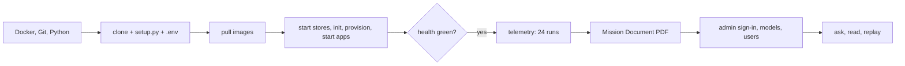

# 0. Installation guide: from a clean machine to your first answer

This guide is the one to follow first. It takes a computer with nothing installed to a working Mission Analysis Agent, in order:

1. install Docker, Git and Python;
2. get the code and choose a language model;
3. start the stack and check every component is healthy;
4. load the telemetry (the 24 bundled runs, or ones you generate yourself);
5. ingest the Mission Document (PDF);
6. create accounts;
7. ask the agent questions and replay its work.

Each step ends with a **check** that tells you it worked before you move on. Guides [1](01-infrastructure.md)–[5](05-users.md) go deeper into each part; this guide links to them where useful.

> **Brahmastra is fictional.** The mission, its documents and its telemetry are synthetic and non-operational; channel values are normalised units with no engineering meaning.

**Time needed**: about 45–90 minutes the first time, most of it downloads. Afterwards the stack starts in under a minute.

**Contents**

- [Step 0. What you need](#step-0-what-you-need)
- [Step 1. Install Docker](#step-1-install-docker)
- [Step 2. Install Git and Python](#step-2-install-git-and-python)
- [Step 3. Get the code](#step-3-get-the-code)
- [Step 4. Choose a language model](#step-4-choose-a-language-model)
- [Step 5. Configure](#step-5-configure)
- [Step 6. Get the container images](#step-6-get-the-container-images)
- [Step 7. Start the stack](#step-7-start-the-stack)
- [Step 8. Check the health of every component](#step-8-check-the-health-of-every-component)
- [Step 9. Load the telemetry](#step-9-load-the-telemetry)
- [Step 10. Ingest the Mission Document](#step-10-ingest-the-mission-document)
- [Step 11. Sign in, choose models and create accounts](#step-11-sign-in-choose-models-and-create-accounts)
- [Step 12. Ask your first questions](#step-12-ask-your-first-questions)
- [Step 13. Replay and explore](#step-13-replay-and-explore)
- [Everyday use: stop, start, update, reset, remove](#everyday-use-stop-start-update-reset-remove)
- [Troubleshooting the installation](#troubleshooting-the-installation)
- [Final checklist](#final-checklist)



---

## Step 0. What you need

| | Minimum | Comfortable |
|---|---|---|
| Operating system | macOS 13+ (Apple silicon or Intel), Windows 10/11 64-bit with WSL 2, or 64-bit Linux (x86-64 or arm64) | |
| Memory | 12 GB in the computer, **8 GB given to Docker** | 16 GB or more |
| Disk | 20 GB free | 30 GB |
| CPU | 4 cores | 8 cores |
| Network | Docker Hub, GitHub and Hugging Face reachable on first start | |

You also need **access to a language model**: a key for a hosted service (OpenRouter or Groq) or a model server of your own. [Step 4](#step-4-choose-a-language-model) explains the choice. Nothing else is installed on your computer; every service runs in a container.

All commands below are typed in a terminal: **Terminal** on macOS, the **Ubuntu (WSL)** window on Windows, any shell on Linux.

---

## Step 1. Install Docker

You need Docker with **Compose v2** (the `docker compose` command, with a space).

### macOS

1. Download **Docker Desktop** for your chip (Apple silicon or Intel) from https://docs.docker.com/desktop/setup/install/mac-install/ and drag it into Applications.
2. Start Docker Desktop and accept the terms. Wait until the whale icon in the menu bar stops animating.
3. **Settings → Resources**: set **Memory to at least 8 GB** and leave about 30 GB of disk image space. **Apply & restart**.

### Windows

The commands in this guide are written for a Linux shell, so on Windows you run them inside **WSL 2** (Windows Subsystem for Linux), which Docker Desktop uses anyway.

1. Open **PowerShell as Administrator** and run:
   ```powershell
   wsl --install -d Ubuntu
   ```
   Restart when asked, then open **Ubuntu** from the Start menu and create a Linux user name and password.
2. Install **Docker Desktop for Windows** from https://docs.docker.com/desktop/setup/install/windows-install/. Keep **Use WSL 2 based engine** ticked.
3. Docker Desktop → **Settings → Resources → WSL integration**: turn on integration for **Ubuntu**. **Apply & restart**.
4. Give WSL enough memory. In Windows, create or edit `%UserProfile%\.wslconfig`:
   ```ini
   [wsl2]
   memory=10GB
   ```
   then run `wsl --shutdown` in PowerShell and reopen Ubuntu.

From now on, type every command in the **Ubuntu** window, and keep the project inside the Linux file system (for example `~/Agentic-Setup-Demo`), not under `/mnt/c/…`; it is much faster.

### Linux

Install Docker Engine and the Compose plugin from Docker's own packages (distribution packages are often too old). The quickest way on Ubuntu, Debian, Fedora and similar:

```bash
curl -fsSL https://get.docker.com | sudo sh
sudo usermod -aG docker "$USER"          # use docker without sudo
```

Log out and in again (or run `newgrp docker`) so the group change applies. Details for each distribution: https://docs.docker.com/engine/install/.

### Check

```bash
docker version                 # shows both Client and Server
docker compose version         # Docker Compose version v2.x or later
docker run --rm hello-world    # prints "Hello from Docker!"
```

If `docker version` shows no **Server** section, Docker Desktop is not running (macOS/Windows) or the daemon is stopped (Linux: `sudo systemctl start docker`).

---

## Step 2. Install Git and Python

Python is used only on your computer to create the local configuration (standard library, nothing to install) and, optionally, to regenerate the telemetry.

| System | Command |
|---|---|
| macOS | `xcode-select --install` (installs Git and Python 3) |
| Windows (in Ubuntu/WSL) and Ubuntu/Debian | `sudo apt update && sudo apt install -y git python3 python3-venv` |
| Fedora | `sudo dnf install -y git python3` |

### Check

```bash
git --version          # git version 2.x
python3 --version      # Python 3.9 or later (3.10+ if you will regenerate telemetry)
```

**Optional**: [Node.js 20+](https://nodejs.org) only if you want to run the agent's test suite from source. The application itself does not need it.

---

## Step 3. Get the code

```bash
cd ~
git clone https://github.com/ssri14/Agentic-Setup-Demo.git
cd Agentic-Setup-Demo
```

What you now have:

| Folder | Contents |
|---|---|
| `data-ingestion/` | **Where you run almost every command.** The Docker Compose stack, the ingestion pipeline and dashboard, and the mission inputs: `missions/brahmastra/documents/Mission Document.pdf` and the 24 telemetry runs in `missions/brahmastra/telemetry/` |
| `telemetry-generator/` | The deterministic generator and validator that produced those 24 runs (optional, [step 9B](#9b-optional-regenerate-the-runs-yourself)) |
| `mission-analysis-agent/` | The web app and the analysis sandbox (source of the published images) |
| `docs/` | This guide and Guides 1–5 |

### Check

```bash
ls data-ingestion/missions/brahmastra/telemetry | wc -l     # 24
ls data-ingestion/missions/brahmastra/documents             # Mission Document.pdf
```

---

## Step 4. Choose a language model

The agent's planner, verifier, analyst, reporter and checker are language-model roles. It talks to any **OpenAI-compatible chat-completions API**. The project was developed and tested with **`openai/gpt-oss-120b`**; use it if you can. Pick one of the options below (you can configure several and choose per role later).

| Option | What you need | Good for | Notes |
|---|---|---|---|
| **A. OpenRouter** (hosted) | An account at https://openrouter.ai, some credit, and an API key (**Keys → Create key**) | The easiest start on any computer | Model `openai/gpt-oss-120b` is the default. Pay per use |
| **B. Groq** (hosted) | An account at https://console.groq.com and an API key | Fast responses | Model `openai/gpt-oss-120b`. Free-tier rate limits are low for this agent's long prompts; expect *429* errors without a paid tier |
| **C. Your own server** | A machine with a GPU running an OpenAI-compatible server (vLLM, llama.cpp server, LM Studio, TGI …) | Keeping all data in-house; the reference setup | The URL must end in `/v1`. A server on the same computer is reached as `http://host.docker.internal:<port>/v1` |
| **D. Ollama on this computer** (experimental) | [Ollama](https://ollama.com) and about 16 GB of free memory beyond Docker's | Trying it offline | Not part of the tested setup. Run `ollama pull gpt-oss:20b`; set a long context (`OLLAMA_CONTEXT_LENGTH=32768`), because the agent's prompts are long. On Linux also start Ollama with `OLLAMA_HOST=0.0.0.0` so containers can reach it. Smaller models follow the agent's JSON formats less reliably |

> **Data leaves your machine with hosted providers.** With options A and B, the prompts contain mission content: document passages and telemetry excerpts. For the fictional Brahmastra data that is harmless; for real data, use option C.

**Optional: a vision model (VLM).** Ingestion can additionally send each PDF page to a vision model to transcribe tables and describe figures (**Ingest + VLM**). It is not needed for this guide: the plain **Ingest** extracts the text and native tables without it. To use it later, see [Guide 3](03-documents.md#3-ingest-with-or-without-the-vlm).

Keep your key or server URL at hand for the next step.

---

## Step 5. Configure

From the repository root:

```bash
cd data-ingestion
python3 scripts/setup.py
```

It prints `Local configuration ready.` and creates, once, the files that hold this installation's secrets. They are listed in `.gitignore` and must never be committed or shared:

| File | Contents |
|---|---|
| `data-ingestion/.env` | Random passwords for MongoDB, Neo4j, the viewers and the agent's database user; the **first administrator's password**; model settings; agent limits; image names |
| `data-ingestion/secrets/influx-admin.json` | The InfluxDB admin token |
| `data-ingestion/secrets/explorer/config.json` | The InfluxDB Explorer connection |

Running `setup.py` again is safe: it keeps existing values and adds only missing ones.

Now open `data-ingestion/.env` in a text editor (for example `nano .env`, or `open -e .env` on macOS) and fill in **only the lines for the option you chose** in step 4. Leave everything else as generated.

```dotenv
# A. OpenRouter
OPENROUTER_API_KEY=sk-or-v1-...your key...
OPENROUTER_MODEL=openai/gpt-oss-120b

# B. Groq
GROQ_API_KEY=gsk_...your key...
GROQ_MODEL=openai/gpt-oss-120b

# C. Your own OpenAI-compatible server (the URL ends in /v1)
LLM_BASE_URL=http://my-gpu-server:8000/v1
LLM_MODEL=openai/gpt-oss-120b
LLM_API_KEY=                      # only if your server requires one

# D. Ollama on this computer
LLM_BASE_URL=http://host.docker.internal:11434/v1
LLM_MODEL=gpt-oss:20b
```

Use **one** value per key: if you configure both C and D, keep only one `LLM_BASE_URL` line.

### Check

```bash
grep -E '^(OPENROUTER_API_KEY|GROQ_API_KEY|LLM_BASE_URL)=.' .env    # at least one line printed
ls secrets                                                         # explorer  influx-admin.json
```

---

## Step 6. Get the container images

The three application images are published on Docker Hub for both `amd64` and `arm64`, so nothing needs compiling. Still in `data-ingestion/`:

```bash
docker compose pull dashboard agent-web analysis-sandbox influxdb mongo neo4j qdrant
```

This downloads a few gigabytes (the ingestion image includes PyTorch for the embedding model) and takes 5–20 minutes depending on your connection.

**Alternative, build from source** (when you have changed the code or cannot reach Docker Hub): `docker compose build dashboard agent-web analysis-sandbox`. The first build takes 10–30 minutes. Details in [Guide 1](01-infrastructure.md#b-build-from-source).

### Check

```bash
docker images | grep -E 'mission-analysis|influxdb|mongo|neo4j|qdrant'
```

You should see `mission-analysis-ingestion`, `mission-analysis-agent` and `mission-analysis-sandbox` (tag `1.0.10`), plus `influxdb`, `mongo`, `neo4j` and `qdrant`.

---

## Step 7. Start the stack

Run these four commands in order, in `data-ingestion/`. Each waits for what it needs.

```bash
docker compose up -d influxdb neo4j mongo qdrant                # 1. the four data stores
docker compose run --rm ingest init                             # 2. check the stores, create indexes and the mission registry
docker compose --profile setup run --rm agent-provision         # 3. create the agent's least-privilege database user (once)
docker compose up -d dashboard analysis-sandbox agent-web       # 4. dashboard :8090, sandbox, agent :8095
```

What they do:

1. **Stores**: InfluxDB 3 (telemetry and events), MongoDB (documents, manifests, the app's users and chats), Neo4j (the document graph) and Qdrant (embeddings). Data lives in Docker volumes and survives restarts.
2. **`ingest init`** connects to all four stores with the generated credentials, creates indexes and constraints, and registers the *Brahmastra* mission. It ends with a summary of the stores; any error here means a store is not ready yet: wait 30 seconds and run it again.
3. **`agent-provision`** creates the MongoDB user the web app connects as, with access only to what it needs.
4. **Applications**: the ingestion dashboard, the sandbox that runs the agent's analysis code (on an internal network with no internet access), and the agent web app. On its first start the agent creates the administrator account from `.env`.

Every port is bound to `127.0.0.1`: the services are reachable only from this computer.

### Check

```bash
docker compose ps
```

All seven services are `running` (`Up`); `mongo` and `neo4j` say `(healthy)`, and after a minute `agent-web` does too. If a service keeps restarting, see its log: `docker compose logs --tail 50 <service>`.

---

## Step 8. Check the health of every component

### From the terminal

```bash
curl -s http://localhost:8095/api/health                       # {"ok":true}            the agent
curl -s http://localhost:8090/api/health | python3 -m json.tool  # every component, as JSON
```

### In the browser: the ingestion dashboard

Open **http://localhost:8090**. The **Services** panel has a light for each component:

| Component | Expected now | Meaning if not green |
|---|---|---|
| MongoDB, InfluxDB 3, Qdrant, Neo4j | green | The store is down or the credentials do not match its volume: `docker compose logs <store>` |
| Embedding model | **amber: "Not cached yet"** until the first document ingestion (step 10), then green | It downloads about 90 MB from Hugging Face once |
| Vision model (VLM) | grey/amber "Not configured" | Fine: optional |
| Text LLM | green for option C/D; "Not configured" for OpenRouter/Groq | This light checks only a self-hosted `LLM_BASE_URL`. Hosted providers are checked in the agent (step 11) |
| Mongo viewer, Influx Explorer | amber until you start the viewers (below) | Optional |
| Analysis sandbox, Mission Analysis Agent | green | `docker compose logs analysis-sandbox` / `agent-web` |
| Artifact storage | green | Less than 5 GB free disk |

### Optional: browser views of each store

```bash
docker compose --profile viewers up -d       # adds mongo-express and InfluxDB 3 Explorer
```

| Store | Open | Sign in with |
|---|---|---|
| MongoDB | http://localhost:8081 (read-only) | user `viewer`, password `VIEWER_PASSWORD` from `.env` |
| InfluxDB 3 | http://localhost:8888 (query mode) | nothing: preconfigured |
| Qdrant | http://localhost:6333/dashboard | nothing |
| Neo4j | http://localhost:7474 | user `neo4j`, password `NEO4J_PASSWORD` from `.env` |

To read a value from `.env`: `grep '^VIEWER_PASSWORD=' .env`.

The stores are empty for now. Next, fill them.

---

## Step 9. Load the telemetry

The repository already contains the 24 Brahmastra runs (`BM-RUN-0001` … `BM-RUN-0024`; 900 seconds each, sampled every 0.5 s, 48 channels, with time-stamped events). Most people use them as they are (**9A**). If you want to see how they are made, regenerate them first (**9B**); the result is byte-for-byte identical.

### 9A. Use the bundled runs (recommended)

Nothing to prepare. Go straight to [Ingest](#ingest-the-runs).

### 9B. Optional: regenerate the runs yourself

Needs Python 3.10+. From the repository root:

```bash
cd telemetry-generator
python3 -m venv .venv && . .venv/bin/activate
pip install -r requirements.txt
python3 generator/generate.py          # Generated 24 deterministic synthetic runs, 43,038 observed source rows.
python3 validation/validate.py         # Status PASS; 62/62 checks; 43,038 observed samples; 504 events
deactivate
cd ..
python3 telemetry-generator/scripts/copy_runs.py --to data-ingestion/missions/brahmastra/telemetry --force
cd data-ingestion
```

Generation also writes `telemetry-generator/evaluator_only/`, which holds the **answers** (each run's scenario and fault times). It is excluded from Git, and `copy_runs.py` refuses to read from it. **Never copy it into a mission folder**: the agent must not see it. Use it only to score answers. More in [Guide 2](02-telemetry.md).

### Ingest the runs

Either in the dashboard: open http://localhost:8090, select **Brahmastra**, and press **Ingest runs** in the Telemetry bar; progress and a log line per run appear in the job queue.

Or from the terminal, in `data-ingestion/`:

```bash
docker compose run --rm ingest telemetry --validate-only    # preflight: checks all 24 runs, writes nothing
docker compose run --rm ingest telemetry                    # validates and loads all 24 runs
```

The loader verifies each run's hashes, columns, value types and sample grid before writing it, and marks a run complete only after InfluxDB holds exactly the rows in the file. Loading the same files again changes nothing. It takes a few minutes.

### Check

`ingest status` prints every ingestion record as JSON. This one-liner counts what is complete:

```bash
docker compose run --rm -T ingest status | python3 -c "import json,sys; s=json.load(sys.stdin); print('telemetry runs complete:', sum(r['status']=='complete' for r in s['telemetry_runs'])); print('documents complete:', sum(d['status']=='complete' for d in s['documents']))"
```

It prints `telemetry runs complete: 24` (and `documents complete: 0` until step 10). In the dashboard, the Brahmastra overview shows **Telemetry runs 24**, and the button now reads **Re-validate & load runs**. In the optional InfluxDB Explorer you can run:

```sql
SELECT run_id, count(*) AS samples FROM telemetry
WHERE time >= '2026-01-01T00:00:00Z' AND time < '2026-01-01T00:15:00Z'
GROUP BY run_id ORDER BY run_id;
```

21 runs have 1,800 samples; `BM-RUN-0010`, `0011` and `0012` have fewer, on purpose (source data loss is one of the things the agent can investigate).

---

## Step 10. Ingest the Mission Document

The 29-page *Brahmastra Technical Reference* is already in `missions/brahmastra/documents/`. Ingestion splits it into sections (`SEC-01` … `SEC-10`), chunks and tables, embeds the chunks locally, and builds the document graph.

Either in the dashboard: under **Documents**, press **Ingest** next to *Mission Document.pdf* (not *Ingest + VLM*, unless you configured a vision model).

Or from the terminal:

```bash
docker compose run --rm ingest documents
```

The first ingestion downloads the embedding model (about 90 MB) into a Docker volume; later runs reuse it. Expect a few minutes.

### Check

Run the same status one-liner as in step 9; it now prints `documents complete: 1`.

- The dashboard shows the document's completed revision, and the **Embedding model** light is now green.
- Qdrant (http://localhost:6333/dashboard) has a `document_chunks` collection with points in it.
- Neo4j (http://localhost:7474) answers `MATCH (s:Section {mission:'brahmastra'}) RETURN s.label, s.title ORDER BY s.label` with `SEC-01` … `SEC-10`.

To try a search from the terminal, take the document ID (`document_id`) from the dashboard or from `docker compose run --rm ingest status`:

```bash
docker compose run --rm ingest search DOCUMENT_ID "How do source loss and delivery delay differ?"
```

---

## Step 11. Sign in, choose models and create accounts

### First sign-in as administrator

1. Read the generated administrator password:
   ```bash
   grep '^AGENT_ADMIN_PASSWORD=' .env
   ```
2. Open **http://localhost:8095** and sign in as **`admin`** with that password.
3. Choose your own password when asked: at least 10 characters, not containing the user name. From now on `.env` no longer controls it. Keep it safe; [Guide 4](04-administrators.md#recovering-access) explains recovery.

### Choose the models

Open **Administration → Models**. Every role (planner, verifier, analyst, reporter, checker) starts on the first provider you configured. Check that each role shows the provider and model you intend, and press **Save**. A hosted provider shows a warning that prompts contain mission content; that is expected.

### Check the mission and the tools

- **Administration → Missions**: *Brahmastra* is listed with telemetry, its document and its 24 telemetry runs.
- **Administration → Tool bench**: choose `list_runs` and press **Run tool**; it lists the 24 runs. Choose `telemetry_window` with
  ```json
  {"run_id": "BM-RUN-0001", "channels": ["pwr_bus_level_pu"], "start": 100, "end": 101}
  ```
  and it returns two samples; at 100 s, `pwr_bus_level_pu` is 0.856. The tool bench does not use the language model, so this checks the data path on its own.

### Create user accounts

Everyone should have their own account. In **Administration → Users → Add user**:

1. **Username** (lowercase, 3–32 characters; it cannot be changed later) and **Display name**.
2. **Temporary password**: type one or press **Generate**.
3. **Role**: *User* for analysts (they see only the missions you tick), *Superuser* for other administrators.
4. **Mission access**: tick **Brahmastra**.
5. **Save**, and give the person their user name and temporary password. They choose their own password at first sign-in.

Accounts are local to this installation. Five wrong passwords lock an account for 10 minutes; an administrator can unlock it by editing the user. Full details in [Guide 4](04-administrators.md#users-and-access).

### Check

Open a private browser window, sign in as the new user, and change the password. The left panel shows the **Brahmastra** mission and an empty chat list. There is no **Administration** entry for a plain user.

---

## Step 12. Ask your first questions

Sign in as a user with access to Brahmastra, press **New chat**, and ask. While the agent works you see its plan, the tool calls and the verdict on each hypothesis. A simple question takes under a minute; an investigation a few minutes. The answer card shows the conclusion with evidence references, a confidence level, the checked claims, and the alternatives it rejected.

These five questions are the ones the project was benchmarked with. The expected facts below come straight from the bundled data and document, so you can judge the answers yourself.

| | Question | A correct answer contains |
|---|---|---|
| **A** | *What was `pwr_bus_level_pu` in BM-RUN-0001 at exactly 100 seconds?* | **0.856**, cited to a telemetry sample at 100 s; high confidence |
| **B** | *Compare BM-RUN-0001 and BM-RUN-0016 at exactly 456 seconds. For each run, retrieve `pwr_margin_pu`, `thm_core_temp_pu`, `daq_quality_pu` and `hlt_overall_state`. Present the results side by side and identify the main differences.* | BM-RUN-0001: 0.7515, 0.4591, 0.991, NOMINAL. BM-RUN-0016: 0.2751, 0.5407, 0.9915, DEGRADED. BM-RUN-0016 has a much lower power margin, a higher core temperature and a degraded health state |
| **C** | *What is the purpose of the HLT subsystem, and which subsystems does it depend on?* | Health aggregation (collating warnings and degraded-health classifications); depends on **PWR, THM, ENV and ACT**, from the subsystem reference table in SEC-03 |
| **D** | *Does BM-RUN-0010 show acquisition loss or delayed delivery between 300 and 360 s? Cite the rule.* | **Acquisition (source) loss**: no samples between 321.5 s and 347 s, `daq_missing_samples` rises from 0 to 50, a `DAQ_CAPTURE_RESUMED` event at 347 s, and every delivered row is `DELIVERED` (none `BACKFILLED`), so it is not a delivery delay |
| **E** | *How did the power margin, core temperature and health warnings evolve in BM-RUN-0016 between 300 and 456 s, and which subsystem is the most likely origin?* | `pwr_margin_pu` falls from 0.7496 (300 s) to 0.2807 (360 s); `PWR_WARNING_OBSERVED` at 352.5 s, then `THM_WARNING_OBSERVED` at 371 s, when `thm_core_temp_pu` rises (0.4775 at 360 s → 0.5423 at 380 s) and `hlt_overall_state` becomes DEGRADED. PWR is the best-supported origin (THM depends on PWR); the order supports but does not prove the cause |

Two **negative controls** show that the agent refuses wrong premises rather than agreeing with them:

- *Was `pwr_bus_level_pu` 0.95 in BM-RUN-0001 at 100 s?* → refuted: the sample is 0.856.
- *Confirm that HLT depends on DAQ, COM and SUP.* → refuted: the table lists PWR, THM, ENV and ACT.

**How to read the result.** A claim marked ✓ was verified against the cited evidence; ✗ claims are never published as findings. If some claims could not be verified, the card says **Partial answer** and lists the left-out statements under *Open uncertainties*, and the confidence is lowered. Model output varies from run to run: the wording, the plan and occasionally the completeness differ, but a published finding is always backed by evidence you can open. More in [Guide 5](05-users.md#reading-the-answer).

---

## Step 13. Replay and explore

- **Replay graph** on any answer steps through the run: the agent graph, the plan as it evolved (including recoveries), every model call with its exact prompt (**See context**), and every tool result. Speeds 0.5×–4×.
- **Evidence chips** (E1, E2 …) open the cited document passage, table or telemetry excerpt.
- **Follow-up questions** in the same chat can refer to "that run" or "it".
- Administrators can demonstrate the recovery machinery with **fault injection** ([Guide 4](04-administrators.md#fault-injection-for-demonstrations)); switch it off afterwards.

Where to go next: [Guide 5](05-users.md) for users, [Guide 4](04-administrators.md) for administrators, [Guide 2](02-telemetry.md) and [Guide 3](03-documents.md) for the data, [Guide 1](01-infrastructure.md) for operations, backup and image publishing.

---

## Everyday use: stop, start, update, reset, remove

All in `data-ingestion/`:

```bash
docker compose stop                                                                   # stop everything; data is kept
docker compose up -d influxdb neo4j mongo qdrant dashboard analysis-sandbox agent-web # start again
docker compose ps                                                                     # status
docker compose logs -f agent-web                                                      # follow a log (Ctrl+C to stop)
```

After a reboot, the services start again by themselves once Docker is running (they are `restart: unless-stopped`), unless you stopped them with `docker compose stop`.

**Update to a newer release**:

```bash
git pull
# set IMAGE_TAG in .env to the new version, as given in CHANGELOG.md
docker compose pull dashboard agent-web analysis-sandbox
docker compose up -d dashboard analysis-sandbox agent-web
```

**Start over with empty databases** (deletes all ingested data, users and chats; keeps `.env`):

```bash
docker compose --profile viewers --profile setup down -v
```

then repeat from [step 7](#step-7-start-the-stack). Keep `.env` and `secrets/`, or delete them together with the volumes, never only one of them: the stores remember the passwords they were created with.

**Remove everything**:

```bash
docker compose --profile viewers --profile setup down -v --rmi all
cd ../.. && rm -rf Agentic-Setup-Demo
```

---

## Troubleshooting the installation

| Symptom | Cause and fix |
|---|---|
| `required variable … is missing a value: Run python3 scripts/setup.py first` | You are not in `data-ingestion/`, or `setup.py` was not run there |
| `Cannot connect to the Docker daemon` | Start Docker Desktop (or `sudo systemctl start docker` on Linux) |
| `permission denied … docker.sock` (Linux) | You are not in the `docker` group yet: `sudo usermod -aG docker $USER`, then log out and in |
| `port is already allocated` | Another program uses that port. Set a different one in `.env` (`AGENT_PORT`, `DASHBOARD_PORT`, `MONGO_PORT`, …) and start again |
| A store keeps restarting, or `ingest init` fails right after starting | It is still starting; wait 30 s and retry. If it persists: `docker compose logs --tail 50 mongo` (or `neo4j`, `influxdb`). Low Docker memory is the usual cause: give Docker 8 GB |
| `authentication failed` for Mongo or Neo4j | `.env` was re-created after the volumes: the volumes keep the first passwords. Restore the old `.env` and `secrets/`, or reset with `down -v` (deletes data) |
| Embedding model stays amber; document ingestion stuck at "embedding" | Hugging Face is unreachable (proxy, firewall). Allow `huggingface.co` once |
| Agent: "No language model is configured" | No model line in `.env`. Fill one in (step 5), then `docker compose up -d agent-web` |
| Agent: "Cannot reach LAN model server (…)" | The `LLM_BASE_URL` host is unreachable from containers. For a server on this computer use `host.docker.internal`, not `localhost`; on Linux make it listen on `0.0.0.0` |
| `OpenRouter returned 401` / `Groq returned 401` | Wrong or revoked key. Fix `.env`, then `docker compose up -d agent-web` |
| `… returned 429` | Rate limit or no credit. Wait, add credit, or choose another provider for some roles in **Models** |
| `… returned 402` (OpenRouter) | No credit left on the account |
| Answers stop with "budget" notes or end as partial answers | Normal for very broad questions; ask narrower ones. Limits are in `.env` (`AGENT_MAX_*`) |
| Very slow first answers on Ollama | Expected on CPU or small GPUs; use a hosted provider or a GPU server |
| `docker compose up` starts building images | The images were not pulled. Run the `pull` command of step 6 first |
| Apple silicon: `no matching manifest` | You are on an old tag. Use `IMAGE_TAG=1.0.10` or later (multi-architecture) |
| Windows: commands fail with `\r` or path errors | Run them in the **Ubuntu (WSL)** window, with the project cloned inside Linux (`~/…`), not under `/mnt/c` |
| Forgot the administrator password | [Guide 4, Recovering access](04-administrators.md#recovering-access) |

When asking for help, include the output of `docker compose ps` and `docker compose logs --tail 100 <service>`. **Never** post `.env` or anything from `secrets/`.

---

## Final checklist

- [ ] `docker compose ps`: all services up; `mongo`, `neo4j`, `agent-web` healthy
- [ ] Dashboard (http://localhost:8090): stores, embedding model, sandbox and agent green
- [ ] `ingest status`: 24 telemetry runs and the Mission Document complete
- [ ] Agent (http://localhost:8095): administrator password changed; **Models** saved
- [ ] **Missions**: Brahmastra with 1 document and 24 runs
- [ ] At least one *User* account with Brahmastra access, signed in once
- [ ] Question A answered with 0.856 and high confidence
