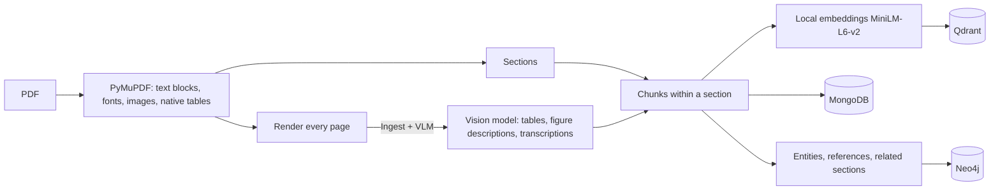

# 3. Chunking and ingesting a document

A mission's documents (manuals, rules, interface descriptions) are what the agent cites as **rules and meanings**. Telemetry tells it what happened; documents tell it what that means. This guide explains how a PDF becomes searchable, linked evidence, and how to ingest one from the dashboard or the command line.

- [What ingestion produces](#what-ingestion-produces)
- [How a PDF is processed](#how-a-pdf-is-processed)
- [1. Put the PDF in a mission](#1-put-the-pdf-in-a-mission)
- [2. Preview the extraction (optional)](#2-preview-the-extraction-optional)
- [3. Ingest, with or without the VLM](#3-ingest-with-or-without-the-vlm)
- [4. Check what was stored](#4-check-what-was-stored)
- [Revisions and settings](#revisions-and-settings)
- [New missions](#new-missions)
- [Troubleshooting](#troubleshooting)

## What ingestion produces

One PDF ends up in four stores, all tied together by stable IDs:

| Store | What is stored |
|---|---|
| MongoDB (`brahmastra`, or `mission_<id>`) | `documents` (one record per revision), `sections`, `chunks` (text, page, bounding box, kind, entity mentions), `assets` (rendered pages, image crops, tables, figure descriptions), `ingestion_jobs` |
| Qdrant (`document_chunks`, or `<id>_chunks`) | One 384-dimension vector per chunk, with `chunk_id`, `section_id`, `document_id`, `page`, `kind` |
| Neo4j | `Document`, `Section`, `Chunk`, `Asset`, `Entity` nodes (each with a `mission` property) and their relationships (below) |
| `data-ingestion/artifacts/<document_id>/` | Rendered page images, crops, `extraction.json`, VLM response cache |

The agent's document tools use all four:

- `search_documents`: semantic search in Qdrant, resolved to MongoDB chunks
- `read_section`: a whole section, plus its previous, next and related sections from Neo4j
- `get_table` and `get_figure`: tables and figure descriptions
- `graph_neighbours`: entities and references
- `lookup_channels`: what the document says about a telemetry channel

## How a PDF is processed



1. **Sections.** The pipeline uses the first of these that the document has:
   - **`SEC-01` … `SEC-10` running headers.** The Mission Document has them; a section can span several pages, and front matter is kept separate.
   - **Top-level PDF bookmarks**, for conventional documents.
   - **Labelled page units**, if the document has neither.

   Finer headings stay inside the text; the pipeline does not guess a heading hierarchy.
2. **Chunks.** Adjacent text blocks on a page and in the same section are grouped up to `CHUNK_CHARS` (1,800) characters and split at word boundaries. A chunk never crosses a major section. Each chunk keeps its page, bounding box, original blocks, character offsets and a `kind`: `text`, `native_table`, or (with the VLM) `vlm_table`, `vlm_description`, `vlm_transcription`.
3. **Tables.** PyMuPDF's native table detection keeps cells and bounding boxes. It can miss tables or return fragments, so these are candidates rather than guaranteed complete tables. The VLM pass reads each rendered page and returns tables as validated rows; row widths are checked.
4. **Figures.** Every page is rendered and embedded images are cropped. With the VLM, a figure that has a visible `FIG-xx —` caption gets a description anchored to it. Images without captions are kept as visual candidates. Model output is labelled `review_status = unreviewed_model_output` and never replaces the source text.
5. **Embeddings.** All embedding happens locally on CPU, using `sentence-transformers/all-MiniLM-L6-v2` (pinned revision). Long chunks are embedded in overlapping windows and pooled, not truncated. No text is sent to a hosted embedding service.
6. **Graph.**

   | Relationship | Meaning |
   |---|---|
   | `HAS_SECTION`, `HAS_CHUNK`, `HAS_ASSET` | Document hierarchy |
   | `NEXT`, `PREVIOUS` | Adjacent sections in reading order |
   | `NEXT_CHUNK` | Chunk order inside a section |
   | `REFERS_TO` | An explicit `SEC-xx` reference in the text |
   | `MENTIONS` | An explicit subsystem, channel, rule or figure ID in the text (lexical) |
   | `RELATED_KEYWORD` | Sections sharing frequent terms (stores the shared terms) |
   | `RELATED_SEMANTIC` | The top-k most similar sections above `SIMILARITY_THRESHOLD` (stores the score) |

   Related links are navigation hints for the agent, not claims that two passages say the same thing.
7. **Completion gate.** A document becomes visible to search and to the agent only when its MongoDB record is `complete`. That happens after the graph is written and the Mongo and Qdrant counts are verified.

## 1. Put the PDF in a mission

Each mission has a documents folder: `data-ingestion/missions/<mission>/documents/`. The Brahmastra Mission Document (Draft 1.0) is already there.

You can add a PDF in either of two ways:

- **Dashboard**: http://localhost:8090 → choose the mission → drag the PDF onto **Drop PDFs here**. Only real PDFs are accepted, up to 200 MB (`MAX_UPLOAD_MB`), and an existing file name is never overwritten.
- **File system**: copy the PDF into the folder. The dashboard lists it on refresh.

Only add documents you are allowed to process. With the VLM enabled, every page image is sent to the configured vision model.

## 2. Preview the extraction (optional)

This is worth doing for a new kind of document. It writes the extraction report without touching any database and without embedding anything:

```bash
cd data-ingestion
docker compose run --rm ingest documents --extract-only                              # every PDF of the mission
docker compose run --rm ingest documents --extract-only --file "Some Manual.pdf"     # one file
```

Open `artifacts/<document_id>/extraction.json` and check:

- that the sections are where you expect;
- the page ranges;
- the chunk count and kinds;
- the detected tables.

If a document has no `SEC-xx` headers and no bookmarks, it falls back to page units. Consider adding bookmarks to the PDF.

## 3. Ingest, with or without the VLM

**Dashboard.** Each file has two buttons:

- **Ingest**: native extraction, embeddings and graph.
- **Ingest + VLM**: the same, plus one vision-model call per page for tables and figures. It is slower and needs a VLM.

The job queue shows progress and a log, one job at a time. Completed revisions are listed under the file.

**Command line**, in `data-ingestion/`:

```bash
docker compose run --rm ingest documents                                   # native, all PDFs of the mission
docker compose run --rm ingest documents --file "Mission Document.pdf"     # one file
docker compose run --rm ingest documents --enrich                          # with the VLM
docker compose run --rm ingest --mission trishul documents --file "Trishul Manual.pdf"   # another mission
```

**Configuring the VLM** in `data-ingestion/.env` (then `docker compose up -d dashboard`):

```dotenv
VLM_BASE_URL=http://my-gpu-server:8002/v1        # any OpenAI-compatible vision endpoint, including /v1
VLM_MODEL=nvidia/NVIDIA-Nemotron-Nano-12B-v2-VL-BF16
VLM_API_KEY=                                      # if the endpoint needs one
VLM_TIMEOUT=120
```

OpenRouter works too (`VLM_BASE_URL=https://openrouter.ai/api/v1` with a vision model). The VLM light in the dashboard's Services panel turns green when the endpoint answers.

VLM behaviour:

- **Cache.** Responses are cached by page image, native text, model and prompt, so a retry reuses accepted answers.
- **Corrections.** Invalid JSON or inconsistent table shapes get up to two correction requests. HTTP errors or a third failure stop the job; there is no silent fall-back to text only.
- **Frozen once complete.** A completed enriched revision is reused as-is. Changing the provider does not quietly rewrite it.

## 4. Check what was stored

```bash
docker compose run --rm ingest status                                              # documents, revisions, status
docker compose run --rm ingest search DOCUMENT_ID "How do source loss and delivery delay differ?"
docker compose run --rm ingest section SECTION_ID                                  # a section and its links
```

In a browser:

- **Qdrant** http://localhost:6333/dashboard → `document_chunks` → *Visualize* with `{"limit": 200, "color_by": {"payload": "section_id"}}`. Chunks of one section cluster together.
- **Neo4j** http://localhost:7474 (user `neo4j`, password `NEO4J_PASSWORD`). Load `data-ingestion/viewers/neo4j_style.grass` with `:style`, then run queries from `viewers/neo4j_demo.cypher`. For example:
  ```cypher
  MATCH p=(d:Document {mission:'brahmastra'})-[:HAS_SECTION]->(s:Section) RETURN p LIMIT 30;
  ```
- **mongo-express** http://localhost:8081: `chunks` with `{"kind": "vlm_table"}` or `{"entities": "daq_missing_samples"}`.
- **The agent**: as a superuser, open *Tool bench → `search_documents`* or `read_section`.

## Revisions and settings

A document revision ID is derived from:

- the PDF's SHA-256;
- the pipeline and PyMuPDF versions;
- `CHUNK_CHARS`;
- the embedding model and revision;
- the VLM model and prompt version;
- the link thresholds.

So:

- Ingesting the **same file with the same settings** again updates the same IDs. It is safe.
- Changing **any** of those settings, or the PDF itself, creates a **new revision** alongside the old one. Native and VLM-enriched ingestions are separate revisions of the same file. For each source PDF the agent uses one complete revision: the VLM-enriched one if there is one, otherwise the most recently updated.
- A **failed job** keeps its failure type and can simply be run again.
- **Embedding model.** One deployment uses one embedding model. To switch models, use a new mission (or a separate deployment) so vectors from different models never share a collection; mixing them is rejected.

## New missions

A mission is an isolated corpus with its own MongoDB database, InfluxDB database and Qdrant collection.

- **Dashboard**: **New mission** → Mission ID (lowercase, 2–31 characters, letter first; e.g. `trishul`), display name, description → **Create mission**.
- **Command line**: `docker compose run --rm ingest create-mission trishul "Trishul" --description "Second fictional mission"`.

This creates `missions/trishul/{documents,telemetry}/`, the database `mission_trishul` and the collection `trishul_chunks`. Upload documents and ingest as above. In the agent, a superuser then grants users the new mission (Guide 4).

Document IDs are content-addressed, so the same PDF with the same settings can belong to only one mission. Ingesting it into a second mission is refused.

## Troubleshooting

| Symptom | Cause and fix |
|---|---|
| Job stuck at "embedding" on first use | The embedding model is downloading (about 90 MB); see the dashboard's embedding light. Without internet access, see Guide 1 |
| `VLM output failed validation after three attempts`, or an HTTP error from the VLM | The vision endpoint is unreachable or returned invalid output; check `VLM_*` and the dashboard light, then run the job again (accepted pages are cached) |
| Only one big section | The PDF has no `SEC-xx` headers or bookmarks; add bookmarks, or accept page units |
| Tables look fragmented | Native table detection is approximate; use **Ingest + VLM** |
| `This document revision is already ingested for mission …` | The same PDF was ingested into another mission; see [New missions](#new-missions) |
| Agent doesn't find a new document | Its record isn't `complete` yet (see `status`), or the user's chat is in another mission. With no complete document at all, the tools answer `Mission … has no completely ingested documents yet` |
