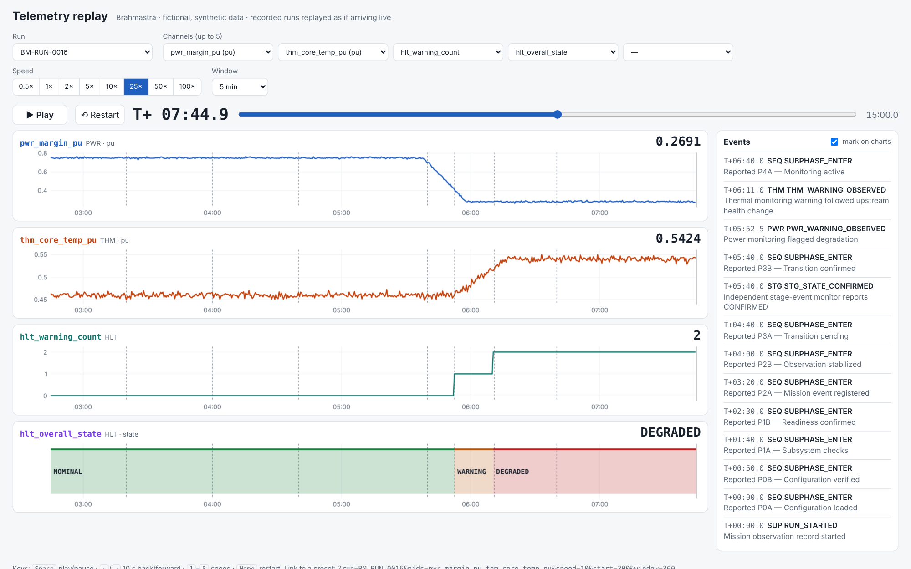

# Telemetry replay

A plain replay of the recorded Brahmastra runs: choose a run and up to **five channels (PIDs)**, then watch them arrive as if live. You can play, pause, seek and change the speed (0.5× to 100×) while it runs. It is the simplest way to *see* the data before asking the agent about it, for example as the opening of a talk.



- **Standard library only.** Python 3.9 or later; no packages, no databases, no Docker needed. It reads the run folders directly (`telemetry.csv`, `events.jsonl`, `run_manifest.json`).
- **Paced by mission time.** Samples are sent at their own mission elapsed time, scaled by the speed. A run with lost samples (BM-RUN-0010, 0011, 0012) shows the gap as it happens: the line breaks, the readings turn grey with "last", and a *No samples for … s* badge counts up.
- **Numbers and states.** Numeric channels are drawn as lines on a fixed scale for the whole run; counters show whole numbers. State channels (`hlt_overall_state`, `delivery_state`, true/false flags) are drawn as coloured bands: green nominal, amber caution, red degraded or fault.
- **Events.** Logged events appear in a side list as they occur and, optionally, as dashed markers on every chart.

The replay is independent of the ingestion stack and of the agent: it changes nothing and needs no credentials.

## Run it

From the repository root:

```bash
python3 telemetry-replay/replay.py
```

Open **http://localhost:8070**. Choose a run, the channels, a speed and a time window, then press **Play**.

| Key | Action |
|---|---|
| <kbd>Space</kbd> | Play / pause |
| <kbd>←</kbd> / <kbd>→</kbd> | 10 s back / forward |
| <kbd>1</kbd>–<kbd>8</kbd> | Speed 0.5×, 1×, 2×, 5×, 10×, 25×, 50×, 100× |
| <kbd>Home</kbd> | Back to the start |

A link can preset the view, which is handy for a slide: `run`, `pids`, `speed`, `start` (seconds into the run) and `window` (`30`, `60`, `120`, `300` or `full`). This one opens the BM-RUN-0016 cascade just before it begins, paused, ready for **Space**:

```
http://localhost:8070/?run=BM-RUN-0016&pids=pwr_margin_pu,thm_core_temp_pu,hlt_warning_count,hlt_overall_state&speed=10&start=290&window=300
```

### With Docker Compose

If the stack is set up ([Installation guide](../docs/00-installation.md)), the replay is also an optional service:

```bash
cd data-ingestion
docker compose --profile replay up -d telemetry-replay      # http://localhost:8070
docker compose stop telemetry-replay
```

It runs the same script in a stock `python:3.12-slim` image, read-only and unprivileged, with the run folders mounted read-only. Set `REPLAY_PORT` in `.env` to use another port.

### In a terminal

The same replay can be printed as rows, without a browser:

```bash
python3 telemetry-replay/replay.py --console --run BM-RUN-0010 --pids daq_missing_samples,pwr_margin_pu,delivery_state --speed 10 --start 315 --events
```

```text
BM-RUN-0010 at 10x from 315 s. Ctrl+C to stop.
  T+ (s)  daq_missing_samples        pwr_margin_pu       delivery_state
-----------------------------------------------------------------------
   321.0                    0               0.7503            DELIVERED
   321.5                    0               0.7489            DELIVERED
          … no samples after 321.5 s
   340.0  ▶ STG STG_STATE_CONFIRMED: Independent stage-event monitor reports CONFIRMED
   340.0  ▶ SEQ SUBPHASE_ENTER: Reported P3B — Transition confirmed
   347.0  ▶ DAQ DAQ_CAPTURE_RESUMED: Source capture resumed; cumulative missing samples 50
          … samples resume (25.0 s without samples)
   347.0                   50               0.7530            DELIVERED
```

`--list` lists the runs (samples, missing samples, events) and the channel names.

## Options

| Option | Default | Meaning |
|---|---|---|
| `--data` | `../data-ingestion/missions/brahmastra/telemetry` | Folder of run folders, for example a freshly generated `telemetry-generator/agent_visible/runs` |
| `--host`, `--port` | `127.0.0.1`, `8070` | Where the browser UI listens. Use `--host 0.0.0.0` only inside a container or on a trusted network |
| `--console` | off | Print the replay in the terminal instead of serving the UI |
| `--run`, `--pids`, `--speed`, `--start`, `--events` | `BM-RUN-0016`, three channels, `10`, `0`, off | What the console replay shows |
| `--list` | | List runs and channels, then exit |

## Suggested runs for a demonstration

| Run | Channels | What you see |
|---|---|---|
| BM-RUN-0016, 300–460 s | `pwr_margin_pu`, `thm_core_temp_pu`, `hlt_warning_count`, `hlt_overall_state` | The power margin falls (PWR warning at 352.5 s), then the core temperature rises (THM warning at 371 s) and health turns DEGRADED: a cascade |
| BM-RUN-0010, 300–360 s | `daq_missing_samples`, `pwr_margin_pu`, `delivery_state` | No samples between 321.5 s and 347 s, then `DAQ_CAPTURE_RESUMED` and 50 missing samples: source data loss |
| BM-RUN-0001 | `pwr_bus_level_pu`, `thm_core_temp_pu` | A nominal run, for comparison |

These are the same situations the agent investigates in the [benchmark questions](../docs/00-installation.md#step-12-ask-your-first-questions).

## How it works

`replay.py` loads a run once and keeps it in memory. For each browser connection it creates a replay clock, which advances by the elapsed wall-clock time multiplied by the speed every 50 ms. The samples and events now due are sent over **Server-Sent Events** (`/api/stream`). Play, pause, seek and speed changes go to `/api/control` and take effect at the next tick. After a seek, the clock first sends up to five minutes of history so the charts fill at once.

The page (`static/index.html`) draws the charts on a canvas with no external libraries, so it also works offline.

| Endpoint | |
|---|---|
| `GET /api/runs` | Runs with sample, missing-sample and event counts |
| `GET /api/runs/<run>/channels` | Channels with kind, unit, subsystem, range or states |
| `GET /api/stream?run=&pids=&speed=&start=&paused=` | The replay as Server-Sent Events: `hello`, then `tick` messages |
| `POST /api/control` | `{"session", "action": "play" \| "pause" \| "speed" \| "seek", "value"}` |
| `GET /api/health` | `{"ok": true, "runs": 24}` |

## Tests

```bash
cd telemetry-replay
python3 -m unittest -v test_replay.py
```

11 tests on the bundled runs: loading and channel kinds, values against the CSV, pacing by mission time, pause, seek and speed, the BM-RUN-0010 gap, the end of a run, and the HTTP endpoints including a live stream.
